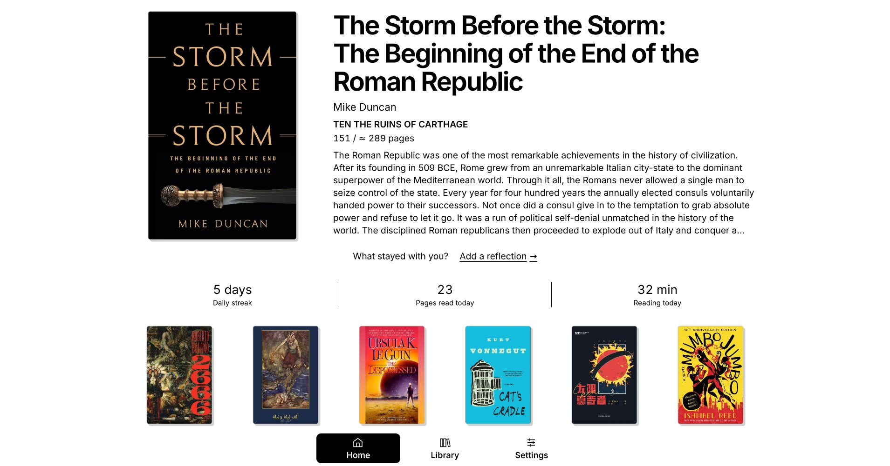
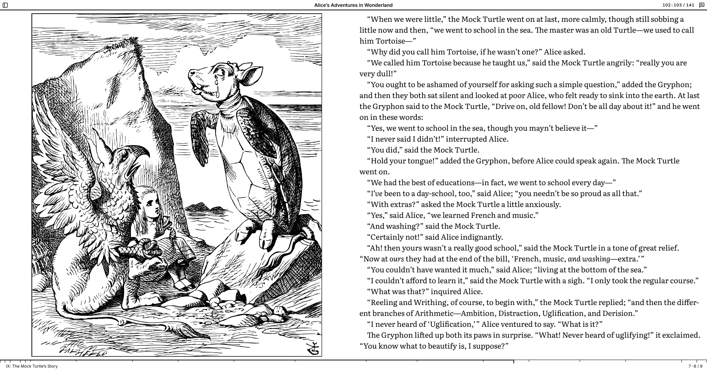
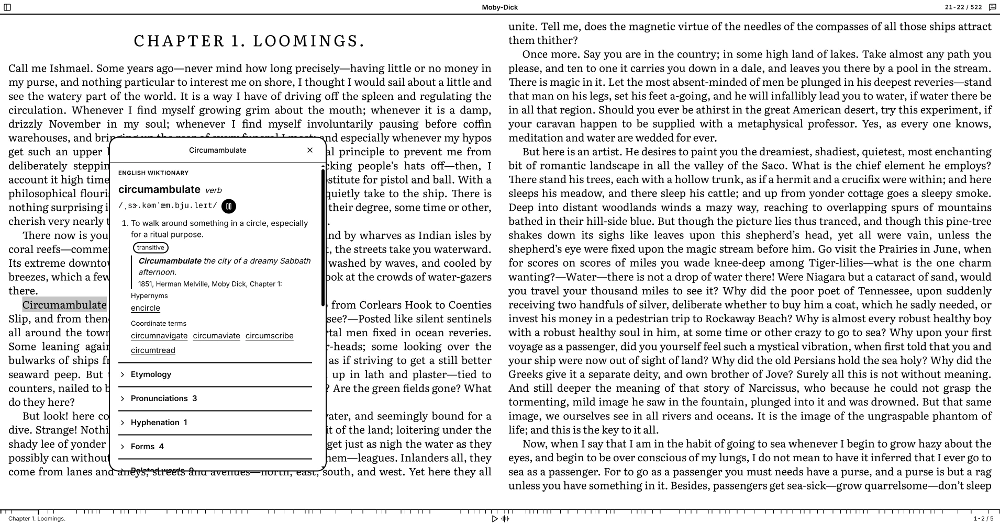
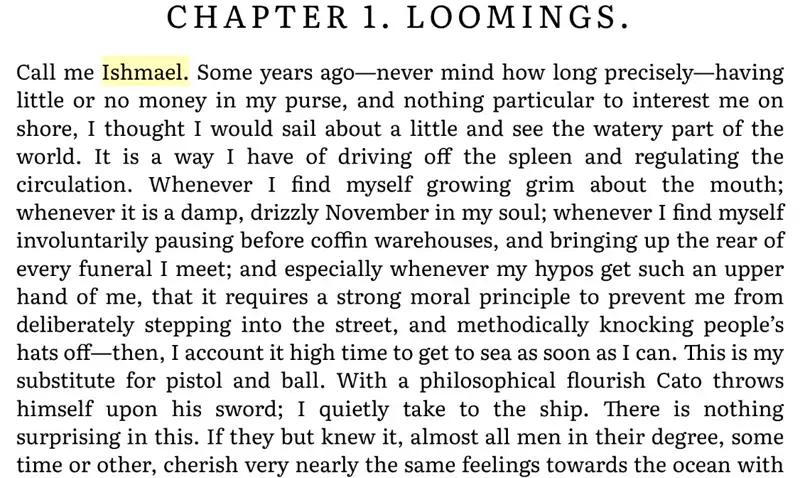
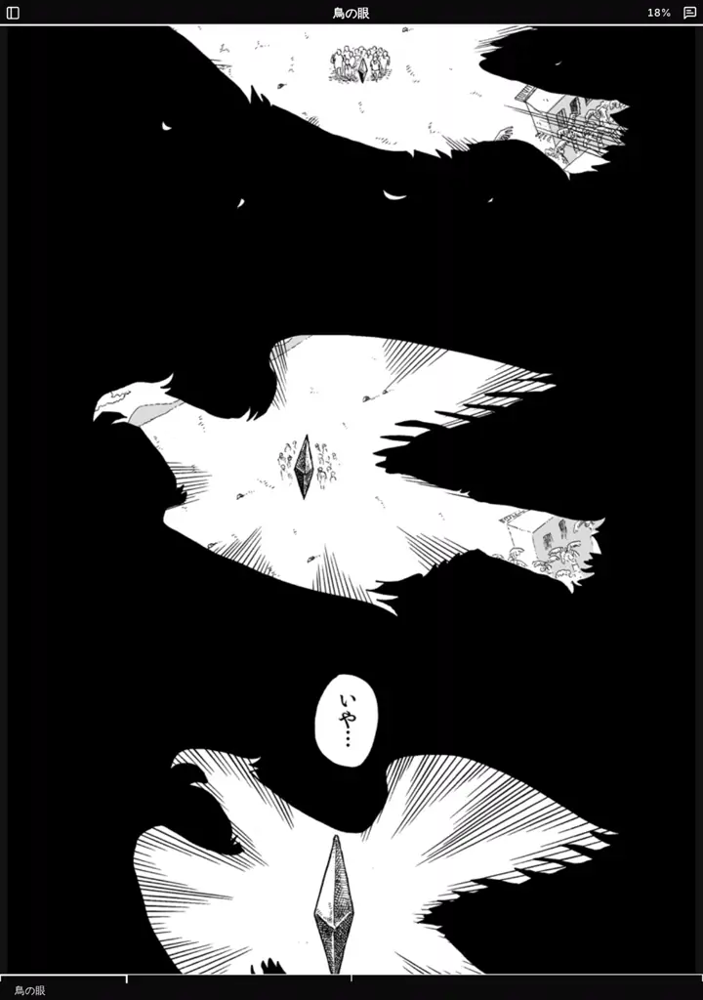

<picture>
  <source media="(prefers-color-scheme: dark)" srcset="art/wordmark-dark.svg">
  
</picture>

**Every word within reach.**

Elephant Ladder is a next-generation EPUB reader, built first for Linux and Android
and running on Windows and macOS. An EPUB is packaged web content — HTML, CSS, images,
sometimes scripts and video. Elephant Ladder is a reader that takes that
seriously. Ordinary books read the way they should. Books with scripts, video, forms,
and interactive pages run too, each isolated on its own browser origin, with no way to
reach your library, your notes, or your device. Dictionaries with pronunciation audio
work offline in seven languages, and audiobook-style narration follows the text.

It is built from three parts: [EPUB Stack](https://github.com/redvelo/epub-stack)
reads the publication, [EPUB Navigator](https://github.com/redvelo/epub-navigator)
presents it, and the native host in this repository stores books, serves them, and
decides what they may do.

<picture>
  <source media="(prefers-color-scheme: dark)" srcset="art/home-dark.webp">
  
</picture>

## What next generation means

- **Books run, safely.** A book's own scripts, video, audio, and forms work when you
  allow them. Each book lives on its own browser origin with its own storage: it
  cannot read another book's data, the reader's, or the application's, and you can
  reset a book's stored data without losing your notes. The first time a book asks
  for active content or the network, the reader asks you and remembers your answer
  for that book.
- **Spec-current, with receipts.** Reflowable and fixed-layout books, spreads,
  right-to-left and vertical writing, and the roll and scrolled layouts of EPUB 3.4.
  The W3C reading-system test suite runs on packaged Linux and Android builds, and
  the implementation reports are committed in this repository.
- **Modern formats everywhere.** AVIF, JPEG XL, and Opus publications read on every
  device, converted where the device cannot decode them.
- **Narration that follows the text.** Media overlays play with the text highlighted
  as it is read; on Android the narration keeps playing with the screen off, with
  controls on the lock screen.
- **Dictionaries for language learning** Select a word to look it up and hear it
  pronounced, entirely offline. Dictionaries are built from Wiktionary and installed
  in the application from the
  [dictionary catalog](https://github.com/redvelo/elephant-ladder-dictionary):
  English, French, German, Spanish, Italian, Japanese, and Chinese, with English
  views of each.
- **Private by design.** No account, no cloud, no analytics. Everything stays on the
  device; the only network requests are the ones you allow a book to make, dictionary
  downloads you start, and links you open in the browser.
- **At home on e-ink.** Page buttons, a page-turn interaction profile, and the
  device's own front-light dialog on BOOX hardware.

<picture>
  <source media="(prefers-color-scheme: dark)" srcset="art/reading-dark.webp">
  
</picture>







And the expected things, done properly: a library with import, reading positions,
bookmarks, highlights, and notes that survive restarts, and search inside a book.

<picture>
  <source media="(prefers-color-scheme: dark)" srcset="art/library-dark.webp">
  
</picture>

## Conformance

The reader runs the W3C EPUB reading-system test suite on packaged Linux and Android
builds. The catalog, expectations, and implementation reports are committed under
`tests/fixtures/w3c-corpus/`. Isolation and active-content behaviour is proved by the
fixtures under `tests/fixtures/`, run through the product's own import and serving
paths on both platforms.

## Development

Node.js 22 or newer, pnpm 11, a stable Rust toolchain, and the sibling
`epub-navigator` checkout beside this repository. On x86 Linux, `nasm` must be on
`PATH` for the AV1 decoder.

```sh
pnpm install
pnpm tauri dev                 # rebuilds Navigator, starts Vite, launches the app
pnpm tauri build               # the packaged Linux build
```

Linux packages bundle CEF and need the `chrome-sandbox` helper installed root-owned
with mode 4755; the Debian and RPM packages do this. AppImage is not supported because
it cannot.

For Android, with a JDK from 17 to 26 and an authorized device attached:

```sh
pnpm android:dev
pnpm android:device:doctor
```

## Testing

```sh
pnpm test                                        # frontend
cargo test --manifest-path src-tauri/Cargo.toml  # native host
pnpm qualify:native-browser:linux                # drives the packaged Linux app through DevTools
pnpm qualify:fixture-runner:desktop              # isolation and active-content fixtures
pnpm qualify:fixture-runner:android              # the same on the attached device
pnpm corpus:w3c:linux                            # the W3C corpus; corpus:w3c:android for the device
```

Important behaviour is verified in packaged Linux and Android builds, not only in
development mode.

## Repository

```text
src/          the application frontend: library, import, settings, dictionaries
src-tauri/    the Tauri shell and the native host crates
tests/        unit, native-browser, and fixture tests, with the test publications
demos/        demonstration publications
art/          wordmarks and screenshots
```

## License

Apache-2.0 or MIT, at your option. Bundled runtime components and test publications
carry their own licenses; see [Third-Party Notices](THIRD_PARTY_NOTICES.md).
